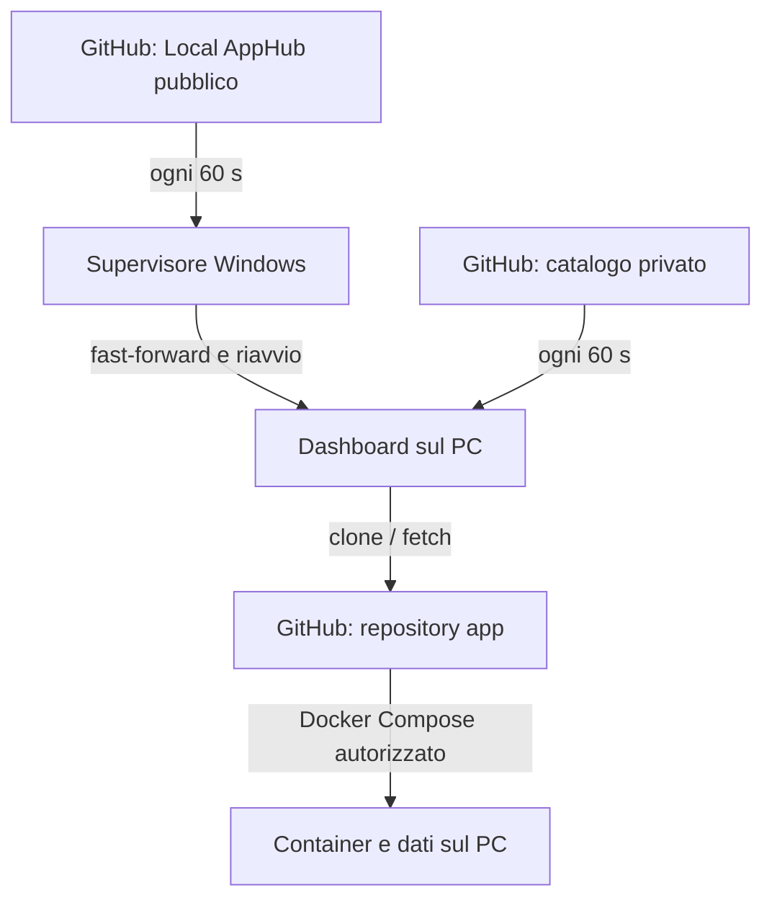

# Local AppHub by iPhone Facile

**Le tue app. Il tuo computer. Un unico posto.**

Local AppHub è un pannello per gestire applicazioni Docker ospitate sul proprio PC. Ogni app mantiene la sua repository GitHub; l'hub legge un catalogo personale, controlla gli aggiornamenti e può installare nuove app automaticamente. La dashboard è pensata anche per il browser del telefono.

> **Versione 0.1.0, MVP pubblico.** Codice e cronologia sono indipendenti dalla vecchia repository privata. Non sono inclusi dati personali, cataloghi reali, password o indirizzi domestici.

## Cosa fa

- Dashboard responsive con categorie, ricerca, stato, pulsanti Installa, Aggiorna, Pausa, Riavvia e Apri.
- Login con password hashata, cookie HttpOnly, protezione CSRF e limitazione dei tentativi.
- Catalogo locale `apps.json` **oppure** catalogo ospitato in una **repository GitHub privata separata**.
- Controllo Git ogni **60 secondi** (configurabile), inclusa rilevazione di app nuove e nuovi commit.
- Deploy tramite Docker Compose da checkout Git versionati, con tentativo di ripristino in caso di aggiornamento fallito.
- Nuove app installate automaticamente **solo se** `autoDeploy: true`; altrimenti aspettano un clic.
- Pausa manuale persistente; le app fermate non ripartono da sole al controllo successivo.
- Installazione Windows con avvio automatico **dopo il login**. Il supervisore controlla anche gli aggiornamenti della repository pubblica Local AppHub ogni minuto.
- Nessuna cancellazione automatica di dati, container o volumi quando un'app viene tolta dal catalogo.

## Installazione Windows

Servono **Python 3.11+**, **Git**, **Docker Desktop** e Docker Compose v2. Docker Desktop deve essere in esecuzione affinché partano i container.

Apri PowerShell:

```powershell
git clone https://github.com/emamangiapia/local-apphub.git
cd local-apphub
powershell -ExecutionPolicy Bypass -File .\scripts\install-windows.ps1
```

Imposta una password di almeno 12 caratteri. L'installer registra l'attività pianificata `iPhoneFacile-LocalAppHub`, avvia il supervisore e rende disponibile la dashboard su **http://127.0.0.1:8766**.

Per provare la dashboard senza installare l'attività pianificata:

```powershell
powershell -ExecutionPolicy Bypass -File .\scripts\install-windows.ps1 -NoScheduledTask
py -3 -m apphub serve
```

I dati personali vengono salvati sul PC, **fuori dal repository Git**, in `%LOCALAPPDATA%\LocalAppHub\`:

```text
auth.json                # hash password
settings.json            # impostazioni personali
apps.json                # catalogo locale opzionale
last_good_apps.json      # ultima copia valida del catalogo remoto
state.json               # stato e pause manuali
git-cache\               # cache repository Git
snapshots\               # versioni Git delle app
app-data\                # cartelle dati permanenti
supervisor.log           # log del supervisore
```

Esegui backup regolari dei volumi Docker e dei dati personali.

## Configurazione delle app

### Opzione A: file sul PC

Modifica `%LOCALAPPDATA%\LocalAppHub\apps.json` partendo da [`examples/apps.example.json`](examples/apps.example.json). Sostituisci i placeholder con repository tue:

```json
{
  "apps": [{
    "id": "le-mie-note",
    "title": "Le mie note",
    "category": "Produttività",
    "repository": "https://github.com/UTENTE/REPOSITORY-APP",
    "branch": "main",
    "composeFile": "compose.yaml",
    "url": "http://localhost:3000",
    "autoDeploy": false
  }]
}
```

### Opzione B: catalogo personale su GitHub

Questa è l'opzione consigliata se vuoi aggiungere un'app da remoto, usando GitHub sul telefono:

1. Crea **una repository GitHub privata solo per le configurazioni**, distinta dalla repo pubblica Local AppHub e da quelle delle singole app.
2. Aggiungi `apps.json` con la struttura mostrata sopra.
3. Autorizza Git sul PC ad accedere alla repository privata (per esempio con Git Credential Manager). Prova un `git clone` manuale per verificare l'accesso. **Non mettere token negli URL.**
4. Nella cartella `local-apphub` esegui:

   ```powershell
   py -3 -m apphub set-config --repo https://github.com/UTENTE/REPO-CONFIG-PRIVATA --branch main --file apps.json
   ```

5. Modifica `apps.json` nella repository privata da qualunque dispositivo. Entro circa 60 secondi, **se PC acceso, utente collegato, Docker Desktop e supervisore operativi**, l'hub rileva le modifiche. Con `autoDeploy: true` clona e avvia una nuova app; con `false` la mostra senza installarla.

Per tornare al catalogo locale: `py -3 -m apphub use-local-config`. Puoi usare **Sincronizza ora** nella dashboard per il controllo immediato. La frequenza si configura con `syncIntervalSeconds` (30-3600) in `settings.json`.

### Significato dei campi

| Campo | Significato |
| --- | --- |
| `id` | Nome univoco, minuscolo, numeri e trattini |
| `title` | Nome mostrato nella dashboard |
| `category` | Categoria per i filtri |
| `repository` | URL HTTPS GitHub della singola app, senza token |
| `branch` | Branch da pubblicare: `main`, `local`, ecc. |
| `composeFile` | File Compose relativo al progetto (`.yaml` o `.yml`) |
| `url` | Indirizzo a cui aprire l'app, opzionale |
| `autoDeploy` | Installazione e aggiornamenti automatici; predefinito `false` |

Il file Compose della tua app può usare la variabile `${APPHUB_DATA_DIR}` per salvare i file in una cartella permanente del PC. Vedi [`examples/compose.example.yaml`](examples/compose.example.yaml). Anche i volumi Docker nominati sono persistenti.

**Dal telefono, `localhost` indica il telefono**, non il PC. I link delle app richiedono un indirizzo raggiungibile dal dispositivo, preferibilmente attraverso VPN privata e HTTPS; l'hub non configura automaticamente i loro reverse proxy.

## Come si aggiornano l'hub e le app



- **Hub:** il supervisore applica solo aggiornamenti fast-forward sulla `main` pubblica se il checkout non contiene modifiche locali; poi riavvia la dashboard lasciando i container delle app in esecuzione.
- **App:** il watcher controlla i branch dichiarati e installa nuovi commit solo dove `autoDeploy` è attivo.
- **App fermate a mano:** non vengono riavviate automaticamente.
- **App tolte dal catalogo:** non vengono eliminate dal disco né da Docker; eventuali pulizie sono manuali.
- **GitHub non raggiungibile:** l'hub conserva l'ultima copia valida del catalogo remoto e ritenta.

Il supervisore parte **al login Windows**, non semplicemente all'accensione elettrica del PC. Per eseguire la piattaforma senza login servirebbe un servizio di sistema distinto. Da PC spento non avvengono controlli.

## Accesso da iPhone e sicurezza

Per impostazione predefinita la dashboard ascolta **solo su `127.0.0.1`**. Per usarla fuori casa configura una **VPN privata**, per esempio Tailscale, e un accesso HTTPS al servizio locale. Non esporre direttamente la porta 8766 su Internet.

Self-hosted non vuol dire automaticamente sicuro. I container possono eseguire software e accedere a dati secondo i permessi concessi; abilita il deploy automatico solo per repository affidabili, non usare container privilegiati e non pubblicare `.env` o segreti. Vedi [`docs/SICUREZZA.md`](docs/SICUREZZA.md).

## Test e stato del progetto

```bash
python -m unittest discover -s tests -v
python -m compileall -q apphub
node --check apphub/static/app.js
```

Questa release è un **MVP**. I test usano Git/Docker simulati. **Il deploy Docker reale e l'attività pianificata Windows non sono ancora stati verificati su un PC Windows.** Mancano editor del catalogo in dashboard, multiutente, backup integrati e configurazione automatica dell'accesso remoto.

## Licenza e autore

Copyright (c) 2026 **Emanuele Mangiapia**, **iPhone Facile**.

Il codice è distribuito con **[PolyForm Noncommercial License 1.0.0](LICENSE)**, licenza *source-available*, **non** open source OSI.

- L'uso non commerciale è consentito nei limiti della licenza.
- Chi redistribuisce copie e modifiche deve mantenere gli avvisi e l'attribuzione richiesti dalla licenza, incluso il [`NOTICE`](NOTICE).
- L'uso commerciale non è concesso automaticamente. Per negoziare autorizzazione e compensi, apri una [issue](https://github.com/emamangiapia/local-apphub/issues).
- Non esistono royalty automatiche: eventuali percentuali sui ricavi devono essere pattuite separatamente.

**Repository ufficiale:** https://github.com/emamangiapia/local-apphub
