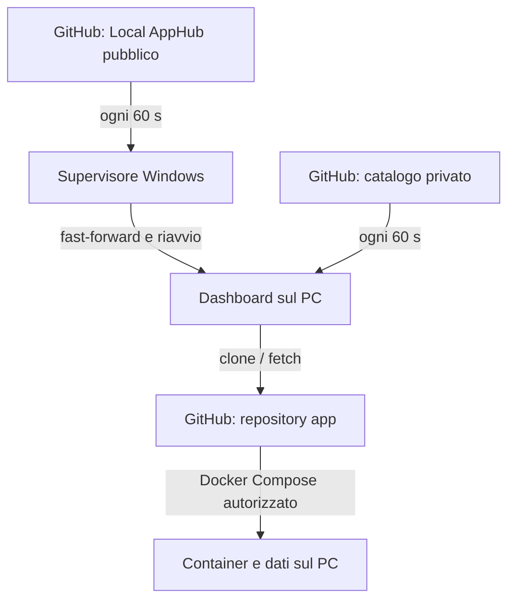

# Local AppHub by iPhone Facile

**Le tue app, sempre con te. La potenza resta a casa.**

Local AppHub è un pannello per gestire applicazioni Docker ospitate sul proprio PC. Ogni app mantiene la sua repository GitHub; l'hub legge un catalogo personale, controlla gli aggiornamenti e può installare nuove app automaticamente. La dashboard è pensata anche per il browser del telefono.

> **Versione 0.5.0, MVP pubblico.** Codice e cronologia sono indipendenti dalla vecchia repository privata. Non sono inclusi dati personali, cataloghi reali, password o indirizzi domestici.

## Cosa fa

- Dashboard **pixel art** responsive, ispirata a una console 8-bit: icone pixel, pannelli da videogioco e colori arcade, con categorie, ricerca, stato e comandi delle app leggibili anche da smartphone.
- **Progressive Web App:** icone per iPhone e Android, installazione dalla schermata Home e pagina di avviso quando il PC non è raggiungibile. Nessuna risposta API privata viene salvata offline.
- **Guida all'accesso privato da telefono:** istruzioni per Tailscale Serve, copia del comando e autorizzazione dell'hostname HTTPS dalla dashboard. Non apre automaticamente porte o tunnel.
- **Prima configurazione guidata** dal browser: password, catalogo personale e controllo dei prerequisiti.
- **Gestione completa delle repository dalla GUI:** aggiungi, modifica e rimuovi app, scegli branch, file Compose, categoria e deploy automatico.
- Se usi un catalogo GitHub privato, le modifiche fatte nella GUI vengono committate e inviate al tuo repository con **push non forzati**.
- Login con password hashata, cookie HttpOnly, protezione CSRF e limitazione dei tentativi.
- Catalogo locale `apps.json` **oppure** catalogo ospitato in una **repository GitHub privata separata**.
- Controllo Git ogni **60 secondi** (configurabile), inclusa rilevazione di app nuove e nuovi commit.
- Deploy tramite Docker Compose da checkout Git versionati, con tentativo di ripristino in caso di aggiornamento fallito.
- Nuove app installate automaticamente **solo se** `autoDeploy: true`; altrimenti aspettano un clic.
- Pausa manuale persistente; le app fermate non ripartono da sole al controllo successivo.
- Installazione Windows con avvio automatico **dopo il login**. Il supervisore controlla anche gli aggiornamenti della repository pubblica Local AppHub ogni minuto.
- Nessuna cancellazione automatica di dati, container o volumi quando un'app viene tolta dal catalogo.

## Installazione Windows

Servono **Python 3.11+**, **Git** e un motore container con **Docker Compose v2** per l'esecuzione delle app.

**Soluzione consigliata: [Rancher Desktop](https://rancherdesktop.io/)**, open source, con motore **Moby/dockerd**. Su Windows usa WSL2 e la virtualizzazione; consulta i [requisiti ufficiali](https://docs.rancherdesktop.io/getting-started/installation/). Se hai già Docker Desktop funzionante, puoi continuare a usarlo. La modalità Rancher `containerd`/`nerdctl` non è compatibile direttamente con i comandi `docker compose` attuali.

Puoi installare Local AppHub anche prima di configurare i container: la dashboard segnalerà cosa manca.

Apri PowerShell:

```powershell
git clone https://github.com/emamangiapia/local-apphub.git
cd local-apphub
powershell -ExecutionPolicy Bypass -File .\scripts\install-windows.ps1
```

L'installer registra l'attività pianificata `iPhoneFacile-LocalAppHub`, avvia il supervisore e apre **http://127.0.0.1:8766**. Al primo accesso sul PC, **crea una password di almeno 12 caratteri nella dashboard**, poi scegli la modalità del catalogo e aggiungi la tua prima repository.

Per provare la dashboard senza installare l'attività pianificata:

```powershell
powershell -ExecutionPolicy Bypass -File .\scripts\install-windows.ps1 -NoScheduledTask
py -3 -m apphub serve
```

I dati personali vengono salvati sul PC, **fuori dal repository Git**, in `%LOCALAPPDATA%\LocalAppHub\`:

```text
auth.json                # hash password
settings.json            # impostazioni personali
apps.json                # catalogo locale opzionale
last_good_apps.json      # ultima copia valida del catalogo remoto
state.json               # stato e pause manuali
git-cache\               # cache repository Git
snapshots\               # versioni Git delle app
app-data\                # cartelle dati permanenti
supervisor.log           # log del supervisore
```

Esegui backup regolari dei volumi Docker e dei dati personali.

## Configurazione delle app

**Non devi modificare JSON a mano.** Dopo il login, usa **Aggiungi app** per collegare le repository e **Modifica configurazione** per aggiornarle o rimuoverle dal catalogo. Nella sezione **Gestisci il tuo catalogo** scegli se conservare l'elenco solo sul PC oppure in una repository GitHub privata, senza uscire dalla dashboard.

La rimozione dal catalogo **non disinstalla** l'app da Docker e non cancella i suoi dati. Per i file JSON e la CLI qui sotto, vedi anche le opzioni avanzate.

### Opzione A: file sul PC

Se preferisci editare direttamente il file invece della GUI, modifica `%LOCALAPPDATA%\LocalAppHub\apps.json` partendo da [`examples/apps.example.json`](examples/apps.example.json). Sostituisci i placeholder con repository tue:

```json
{
  "apps": [{
    "id": "le-mie-note",
    "title": "Le mie note",
    "category": "Produttività",
    "repository": "https://github.com/UTENTE/REPOSITORY-APP",
    "branch": "main",
    "composeFile": "compose.yaml",
    "url": "http://localhost:3000",
    "autoDeploy": false
  }]
}
```

### Opzione B: catalogo personale su GitHub

Questa è l'opzione consigliata se vuoi aggiungere un'app da remoto, usando GitHub sul telefono:

1. Crea **una repository GitHub privata solo per le configurazioni**, distinta dalla repo pubblica Local AppHub e da quelle delle singole app.
2. Aggiungi `apps.json` con la struttura mostrata sopra.
3. Autorizza Git sul PC ad accedere alla repository privata (per esempio con Git Credential Manager). Prova un `git clone` manuale per verificare l'accesso. **Non mettere token negli URL.**
4. Dalla dashboard vai su **Gestisci il tuo catalogo**, seleziona **Repository GitHub privata**, inserisci URL, branch e file e premi **Salva impostazioni**. In alternativa, dalla cartella `local-apphub` usa la CLI:

   ```powershell
   py -3 -m apphub set-config --repo https://github.com/UTENTE/REPO-CONFIG-PRIVATA --branch main --file apps.json
   ```

5. Da questo momento puoi modificare `apps.json` direttamente su GitHub **oppure usare la dashboard**, che esegue commit e push alla stessa repository privata. Entro circa 60 secondi, **se PC acceso, utente collegato, motore container e supervisore operativi**, l'hub rileva le modifiche. Con `autoDeploy: true` clona e avvia una nuova app; con `false` la mostra senza installarla.

**Nota:** per scrivere nel catalogo remoto dalla GUI Git deve disporre delle credenziali con permesso di push. Se un altro dispositivo ha aggiornato il branch nel frattempo, il push viene rifiutato invece di sovrascrivere la sua modifica.

Per tornare al catalogo locale: `py -3 -m apphub use-local-config`. Puoi usare **Sincronizza ora** nella dashboard per il controllo immediato. La frequenza si configura con `syncIntervalSeconds` (30-3600) in `settings.json`.

### Significato dei campi

| Campo | Significato |
| --- | --- |
| `id` | Nome univoco, minuscolo, numeri e trattini |
| `title` | Nome mostrato nella dashboard |
| `category` | Categoria per i filtri |
| `repository` | URL HTTPS GitHub della singola app, senza token |
| `branch` | Branch da pubblicare: `main`, `local`, ecc. |
| `composeFile` | File Compose relativo al progetto (`.yaml` o `.yml`) |
| `url` | Indirizzo a cui aprire l'app, opzionale |
| `autoDeploy` | Installazione e aggiornamenti automatici; predefinito `false` |

Il file Compose della tua app può usare la variabile `${APPHUB_DATA_DIR}` per salvare i file in una cartella permanente del PC. Vedi [`examples/compose.example.yaml`](examples/compose.example.yaml). Anche i volumi Docker nominati sono persistenti.

**Dal telefono, `localhost` indica il telefono**, non il PC. I link delle app richiedono un indirizzo raggiungibile dal dispositivo, preferibilmente attraverso VPN privata e HTTPS; l'hub non configura automaticamente i loro reverse proxy.

## Come si aggiornano l'hub e le app



- **Hub:** il supervisore applica solo aggiornamenti fast-forward sulla `main` pubblica se il checkout non contiene modifiche locali; poi riavvia la dashboard lasciando i container delle app in esecuzione.
- **App:** il watcher controlla i branch dichiarati e installa nuovi commit solo dove `autoDeploy` è attivo.
- **App fermate a mano:** non vengono riavviate automaticamente.
- **App tolte dal catalogo:** non vengono eliminate dal disco né da Docker; eventuali pulizie sono manuali.
- **GitHub non raggiungibile:** l'hub conserva l'ultima copia valida del catalogo remoto e ritenta.

Il supervisore parte **al login Windows**, non semplicemente all'accensione elettrica del PC. Per eseguire la piattaforma senza login servirebbe un servizio di sistema distinto. Da PC spento non avvengono controlli.

## Accesso da iPhone e sicurezza

Per impostazione predefinita la dashboard ascolta **solo su `127.0.0.1`**. Per usarla fuori casa configura una **VPN privata**, per esempio Tailscale, e un accesso HTTPS al servizio locale. Non esporre direttamente la porta 8766 su Internet.

### Local AppHub dalla schermata Home

1. Installa Local AppHub sul PC e completa la prima configurazione e la password **sul PC**, attraverso `http://127.0.0.1:8766`.
2. Installa [Tailscale](https://tailscale.com/download) sul PC e sul telefono e assicurati che entrambi i dispositivi siano autorizzati nella stessa rete privata (tailnet). Abilita i certificati HTTPS dalla configurazione Tailscale, se richiesto.
3. Sul PC, in PowerShell, esegui `tailscale serve --bg 8766`: Serve pubblica la dashboard **soltanto nella tailnet**, usando un proxy HTTPS verso il servizio locale. **Non** utilizzare `tailscale funnel`, che può esporre servizi su Internet.
4. Esegui `tailscale serve status` per trovare il nome HTTPS privato. Apri **Sul telefono** nella dashboard, inserisci **solo l'hostname** (ad esempio `pc.tailnet.ts.net`, senza `https://`) e premi **Salva hostname**. Il nome viene memorizzato esclusivamente in `settings.json` sul PC e autorizzato dall'hub senza riavviare il server.
5. Sul telefono collegato a Tailscale visita l'URL HTTPS, effettua l'accesso e premi **Aggiungi alla Home**. Su iPhone apri in Safari, usa **Condividi → Aggiungi alla schermata Home**; su altri dispositivi usa la procedura suggerita dal browser.

L'app installata occupa comunque una piccola quantità di spazio e usa il browser per la visualizzazione, ma l'elaborazione e i dati delle applicazioni restano sul PC. L'unica pagina utilizzabile offline è l'avviso di connessione: **le API, le sessioni e i dati personali non vengono salvati nella cache del service worker**. Se il PC è spento o Tailscale non è raggiungibile, le app non funzionano. Per l'accesso alle **singole** app, il relativo campo `url` deve contenere un URL raggiungibile dal telefono: `localhost` sul telefono **non è** il PC.

Questa guida **non configura automaticamente Tailscale sul sistema né abilita accesso pubblico**. La configurazione di autenticazione e l'eventuale esposizione di servizi rimangono una scelta dell'utente. Per altre soluzioni, come Cloudflare Tunnel, bisogna aggiungere protezioni di accesso separate e autorizzare il dominio attendibile.

Self-hosted non vuol dire automaticamente sicuro. I container possono eseguire software e accedere a dati secondo i permessi concessi; abilita il deploy automatico solo per repository affidabili, non usare container privilegiati e non pubblicare `.env` o segreti. Vedi [`docs/SICUREZZA.md`](docs/SICUREZZA.md).

### Temi grafici: Retro 8-bit e Liquid

L'utente può scegliere tra due temi dall'interfaccia, **già durante il primo avvio**, dalla pagina di accesso, dal selettore nella barra superiore e dalla sezione delle impostazioni:

- **Retro 8-bit**, predefinito: pixel art, illustrazioni locali e pannelli arcade. Stili in [`apphub/static/pixel.css`](apphub/static/pixel.css).
- **Liquid**: tema originale ispirato alle superfici traslucide, con sfondi morbidi, sfocature, riflessi e pannelli arrotondati. Stili in [`apphub/static/liquid.css`](apphub/static/liquid.css). Non usa nomi, icone o asset ufficiali di altri produttori per identificare il tema.

La preferenza viene salvata **nel browser del dispositivo**. Per esempio, puoi usare Liquid su iPhone e Retro 8-bit sul PC. Non vengono salvate password o credenziali nella preferenza. Entrambi i temi funzionano senza CDN e la scelta non modifica i dati delle app o il catalogo.

La scelta del nome Liquid non garantisce da sola l'assenza di problemi di proprietà intellettuale: il tema deve mantenere un'identità visiva originale e non presentarsi come interfaccia ufficiale di terze parti.

## Setup automatico con Codex, Claude e altri agenti AI

Il repository include istruzioni leggibili dagli agenti:

- [`AGENTS.md`](AGENTS.md) per Codex e altri agenti compatibili;
- [`CLAUDE.md`](CLAUDE.md) per Claude Code;
- [`AI_SETUP.md`](AI_SETUP.md) come punto di ingresso universale;
- [`docs/AGENT_AUTOPILOT.md`](docs/AGENT_AUTOPILOT.md) con il **playbook passo passo** di installazione e verifica;
- [`.github/copilot-instructions.md`](.github/copilot-instructions.md) per GitHub Copilot.

L'agente può occuparsi di controlli, installazione, avvio e verifica nel suo ambiente. Password, permessi amministrativi e collegamento a repository private possono richiedere l'intervento dell'utente con il normale sistema di autenticazione. Nessun agente è autorizzato ad aggirare questi passaggi.

## Test e stato del progetto

```bash
python -m unittest discover -s tests -v
python -m compileall -q apphub
node --check apphub/static/app.js
```

Questa release è un **MVP**. I test includono Git reale per il catalogo e Git/Docker simulati per i deploy. **Il deploy Docker reale e l'attività pianificata Windows non sono ancora stati verificati su un PC Windows.** Mancano ancora multiutente, backup integrati e configurazione automatica dell'accesso remoto: la guida Tailscale richiede passaggi espliciti da parte dell'utente.

## Licenza e autore

Copyright (c) 2026 **Emanuele Mangiapia**, **iPhone Facile**.

Il codice è distribuito con **[PolyForm Noncommercial License 1.0.0](LICENSE)**, licenza *source-available*, **non** open source OSI.

- L'uso non commerciale è consentito nei limiti della licenza.
- Chi redistribuisce copie e modifiche deve mantenere gli avvisi e l'attribuzione richiesti dalla licenza, incluso il [`NOTICE`](NOTICE).
- L'uso commerciale non è concesso automaticamente. Per negoziare autorizzazione e compensi, apri una [issue](https://github.com/emamangiapia/local-apphub/issues).
- Non esistono royalty automatiche: eventuali percentuali sui ricavi devono essere pattuite separatamente.

**Repository ufficiale:** https://github.com/emamangiapia/local-apphub
